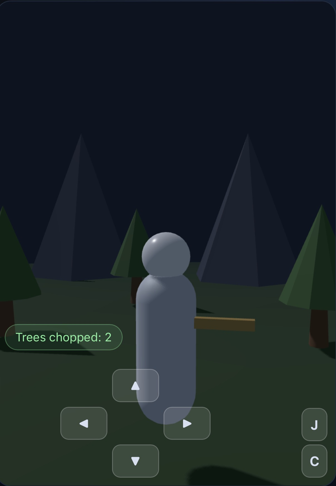

# chop-n-bike

Web-based 3D platformer adventure game with 6 unique levels, compatible with desktop and mobile



## Description

This is a multi-level 3D platformer game where you progress through diverse environments, each with unique mechanics and challenges. The game features a stickman character with arms and legs who can run, jump, climb, swim, and wield a sword.

The camera uses an over-the-shoulder view, allowing you to see your character's back while exploring the worlds.

## The Levels

### Level 1: Dark Forest
The adventure begins in a mysterious dark forest bounded by a ring of mountains. This procedural terrain features:
- Dense forest with 85 trees you can chop down with your sword
- Circular paths to guide your exploration
- Hidden bike reward that increases your movement speed
- Glowing cyan portal exit once you find your way through

**Design Note**: The original concept focused on exploration and resource gathering, with the satisfying mechanic of clearing your own path through the trees.

### Level 2: Ocean World
*"Build out the second level for after the player completes the first level (i.e. exiting the dark forest of level 1). The second level is an ocean level full of water, and more daylight-lit... The level's exit is hidden somewhere underwater."*

Emerging from the dark forest, you find yourself in a bright, expansive ocean:
- Naturally sink slowly in water, with faster sinking on Shift key (desktop) or Sink button (mobile)
- 25 floating trees you can climb but cannot chop
- Jellyfish enemies swimming in the depths
- Jump button enables swimming upward
- Stand on tree tops and jump between them
- Movement is naturally slower in water than in air
- Exit portal hidden deep underwater

### Level 3: Train & Maze
Jump aboard a moving train circling an ancient track:
- Ride the continuously moving train around the circular track
- Time your jump from the train to the platform
- Navigate through a golden maze
- Find the portal at the maze's center
- Strategic challenge: when to jump off the train?

### Level 4: Space Planets
Float through space and leap between spherical worlds:
- Each planet has its own gravity
- Jump from planet to planet in zero-gravity space
- Five planets to explore
- Exit portal located on the golden fifth planet
- Master gravity-assisted jumps to progress

### Level 5: Moon Surface
Explore a cratered lunar landscape:
- Navigate moon craters and rough terrain
- Battle green aliens with your sword
- Low-gravity environment
- Exit portal hidden somewhere on the moon

### Level 6: Pink Island
The final challenge on a vibrant pink island:
- Surrounded by ocean waters
- Pink trees dotting the landscape
- Pink skull enemies to defeat
- Find the final exit portal to complete your journey

Each level was thoughtfully designed to introduce new mechanics and build on skills learned in previous stages, creating a progressive adventure from dark forest to alien worlds.

## Controls

This is a web game and can load in a browser. On deskop the controls would be WASD or the arrow keys for movement, the spacebar to jump, k, to swing the sword, and mouse controls to change the direction the player is facing. On mobile devices, use touch-screen controls similar to Minecraft Bedrock Edition: left side has a displayed touch-pad, right-side has two buttons to tap for jump or sword-strike. Touching in other areas of the screen can rotate the camera.

## Frameworks

This is based on Three.js with whatever additional overarching framework Three.js would be paired with, such as NextJS.

## Getting Started

```bash
npm install      # Install dependencies
npm run dev      # Start development server with hot reload
npm run build    # Production build
npm run start    # Start production server
npm run lint     # Run ESLint
```
